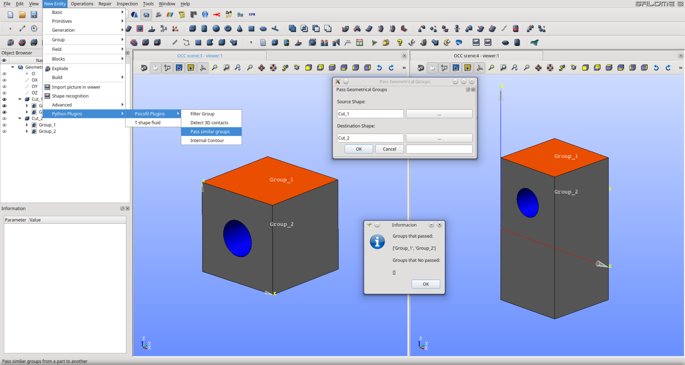
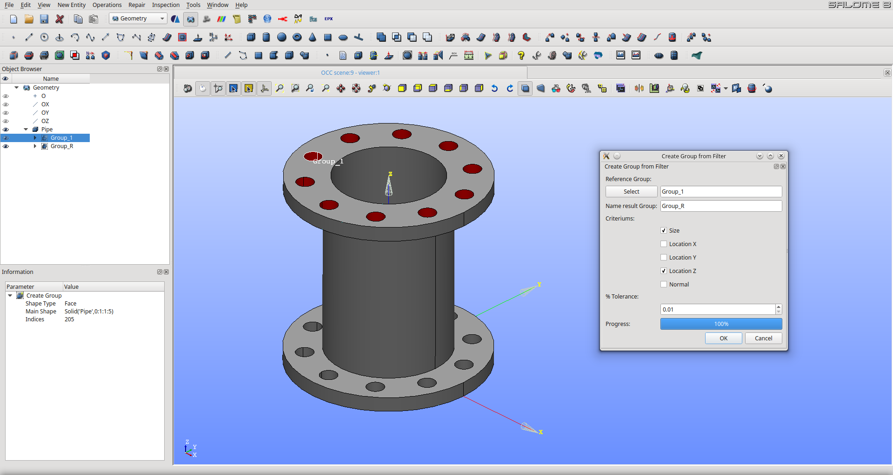
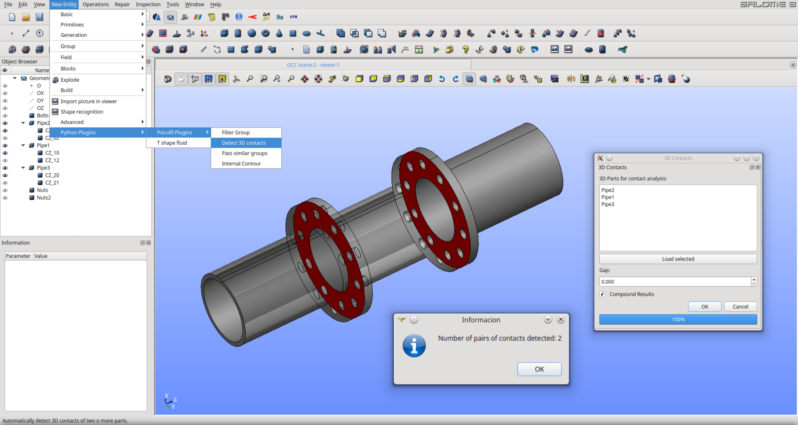
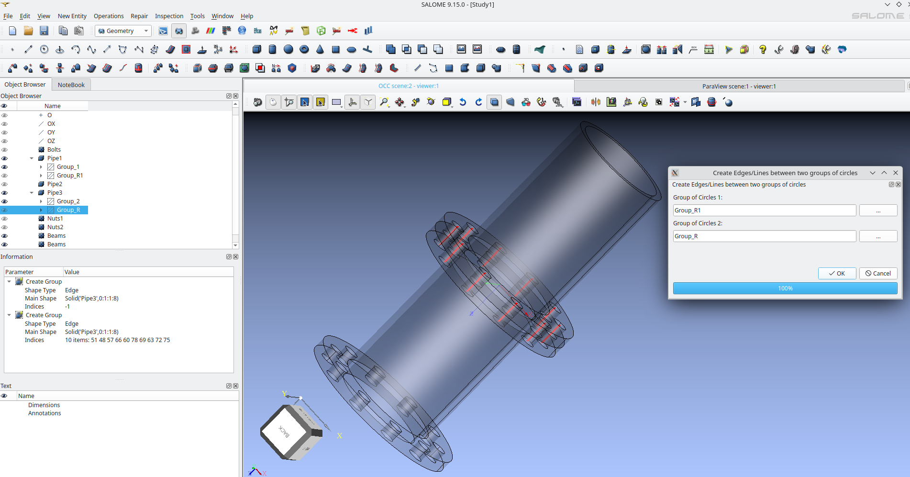
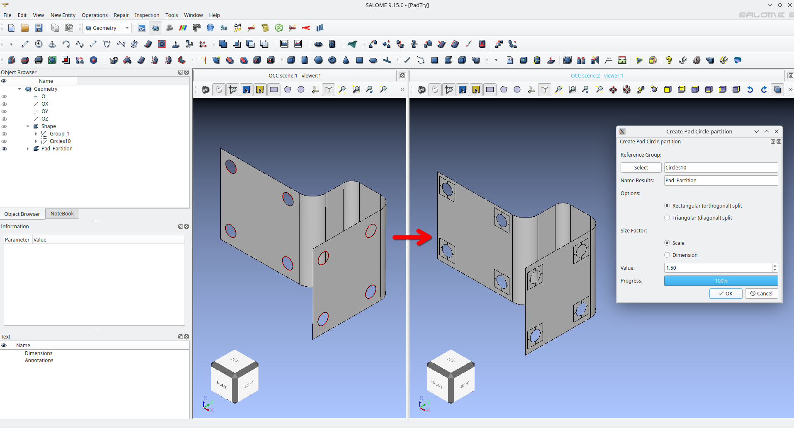
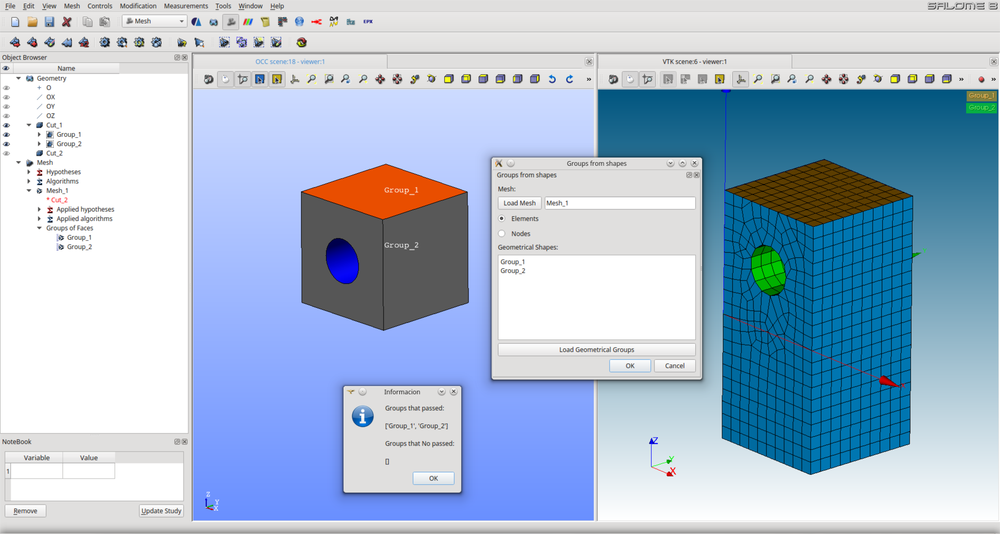
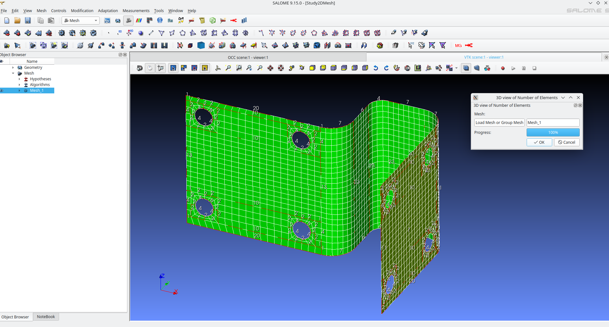

# Salome_Plugins

Collection of scripts for the Salome platform.

# Install Instructions

**On Linux**:

Copy the Plugins folder and its contents to the following address:

* /home/USER_NAME/.config/salome

change USER_NAME by your username

**On Windows**:

Copy the Plugins folder and its contents to the following address:

* C:/Users/USER_NAME/.config/salome

change USER_NAME by your username

**On Salome_Meca**:

Use the bind option with the salome_meca launcher. 

* --bind "/home/$USER/.config/salome" "/home/salome/.config/salome"

## Geometry Module (GEOM)

Video Demostration: https://www.youtube.com/watch?v=W_JMXui-vkI

### Pass similar Group

After an operation in the geometry module the groups are lost and must be done again. 
With this script you can pass the groups (or the majority) after performing an operation to the part.

Autor: @psicofil (Lucio Gomez)

### Filter Group

Creating Geometry groups in the GEOM module using features and properties of another group.

Autor: @psicofil (Lucio Gomez)

Video Idea Demostration (Old Video): https://www.youtube.com/watch?v=Nil1zQtyf_8

### 3D Contact

Script to automatically detect contacts of two o more parts.

Autor: @psicofil (Lucio Gomez)

Video Idea Demostration (Old Video): https://www.youtube.com/watch?v=QTaSs1JFrHw

### Create Edges/Lines between two groups of circles

Create edges/lines between two groups or compounds of circles. Useful for beam-bolt models.

Autor: @psicofil (Lucio Gomez)

### Hole Partition

Creates a radial “pad” layout, splitting the area around a hole into four blocks suitable for mapped meshing

Autor: @psicofil (Lucio Gomez)

### Mid surface

Extract mid surfaces (neutral fibres) from thin solids. Opposite faces are paired by thickness, normals and canonical type, then one face is offset by half the gap and clipped with the solid.

1. Select a solid or compound and launch **Geometry > GEOM plugins > Scope Plugins > Mid surface**.
2. **Load selected**, review the detected pairs, uncheck any you do not want.
3. **Apply** publishes `{name}_M`, with one child per surface named `SXX_t_yy.yy` (sequential index and thickness with 2 decimals).

Use **Manual (two faces)** when auto-pairing misses a wall. Max thickness `0` means 10 % of the bounding-box diagonal. Works for plates, L/T, tubes and thin-walled boxes; the resulting faces are not joined at folds.

Autor: @psicofil (Lucio Gomez)

### Get all beams

Extract a centerline EDGE (beam axis) from each prismatic solid: cylinders, extruded profiles, or a compound of them.

The engine is `get_all_beams.py` (algorithm). The GEOM dialog is `geom_get_all_beams.py`.

1. Select solids or a compound and launch **Geometry > GEOM plugins > Scope Plugins > Get all beams**.
2. **Load selected** explodes the selection into solids and lists them.
3. **Apply** publishes `Beams` (compound of centerlines). Optionally publish each beam as `Beams_1`, `Beams_2`, ...

Works best on members with a clear longitudinal direction. Bent, branched or plate-like solids may be skipped.

Autor: @psicofil (Lucio Gomez)

## Mesh Module (SMEHS)

### Belong to Geometry

Create mesh groups from geometry, even if the link does not exist.

Autor: @psicofil (Lucio Gomez)

### Edge Element Distribution - Number of Elements

Displays a three-dimensional visualization of the number of mesh elements along each edge of a mesh or mesh group, providing an immediate view of edge-wise element distribution.
Note: Performance is not optimal; I recommend using mesh groups rather than a global mesh.

Autor: @psicofil (Lucio Gomez)

### Circle node groups

From a geometry group of hole edges, explode circular segments, pair semi-circles / arcs that belong to the same hole, and create one mesh NODE group per circle. Optionally insert the hole center node (and a 0D element) so the groups are ready for `LIAISON_SOLIDE` or `LIAISON_RBE2` in Code_Aster.

1. Select the mesh and launch **Mesh > SMESH plugins > Scope Plugins > Circle node groups**.
2. Select the GEOM group of circular edges and click **Capture geometry selection**.
3. Review the detected / paired circles, then **Apply**.

Created groups (prefix `HOLE` by default):

* `HOLE_01` : circumference nodes + center node (`LIAISON_SOLIDE`)
* `HOLE_01_ESCL` : circumference only (`GROUP_NO_ESCL`)
* `HOLE_01_MAIT` : center node (`GROUP_NO_MAIT`)

Autor: @psicofil (Lucio Gomez)

### Free Nodes to 0D Elements

Detect free nodes in the selected mesh and generate 0D elements at those locations. If any vertex groups exist, create corresponding 0D elments groups. It is necessary to **Update** the view/mesh or show the created 0D node group (*OD_FreeNodes*) to see the elements.

Autor: @psicofil (Lucio Gomez)

## General Tools

### Fea Unit Converter

Gui to converts values and scaling factors across different engineering unit systems. Supports "SI, Standard", "SI, mm", "Imperial, inches", "Imperial, feet" units systems.

Supported Quantities:
    
* Mechanical: Force, Mass, Length, Pressure, Acceleration, Density
    
* Thermal: Energy, Power, Temperature (absolute or ΔT), Heat Flux, Specific Heat, Conductivity, Convection
    
Autor: @psicofil (Lucio Gomez)
